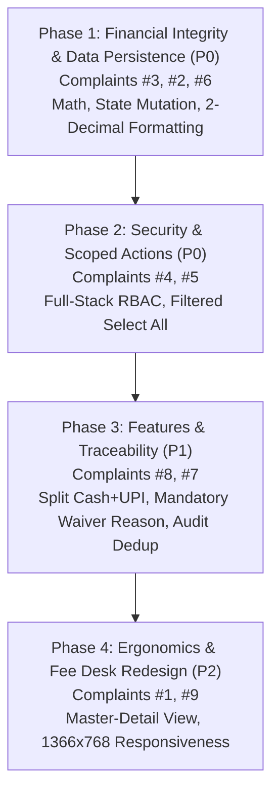

# Front-Desk ERP Triage Report: Delahio School ERP

**Date:** 2026-11-22  
**Target Viewport:** 1366×768 (Front-counter laptop constraint)  
**Baseline Dataset:** `server/seedData.json` (40 seeded students, 6 daybook ledger entries)  
**Status:** Pre-implementation triage and investigation (Zero application code modified)

---

## 1. Test Environment & Baseline

- **Hardware & Viewport Simulation:** 1366×768 resolution (simulated via Chrome DevTools responsive emulation) representing the front-desk counter laptop.
- **Operating Roles Evaluated:** `ADMIN`, `ACCOUNTANT`, `RECEPTIONIST` (configured in `src/core/permissions.js`).
- **Data State Management:** Baseline in-memory state hydrated from `server/seedData.json`, resettable at any time via `POST /api/reset` or the header **Reset data** trigger.
- **Local Application Architecture:** Single-service architecture with Express JSON API on port 3000 (`server/index.js`) and Vite React frontend on port 5173 (`src/App.jsx`).

---

## 2. Reported Complaints — Reproduction Playbook & Technical Diagnosis (1 to 9)

### Complaint #1: Layout Overflow & Unreachable Payment Button
- **User Story / Persona:** Front-desk clerk (`RECEPTIONIST` / `ACCOUNTANT`)
- **Target Seed Record(s):** Venkatanarasimharajuvaripeta Subramanium (`STU-2025-007`, Class: `10-A`, Roll: `1007`, Tuition: ₹48,000, Scholarship: 10%, Late Fine: ₹1,200, Paid: ₹24,000, 15 payment history items, 204-character address)
- **Reproduction Status:** `[Pending Live Check — Expected: Reproduced]`
- **Exact Reproduction Steps:**
  1. Click **Reset data** in the header and switch role to `RECEPTIONIST`.
  2. Navigate to **Fee Desk** tab with viewport set to `1366×768`.
  3. Attempt to scroll vertically through the table to reach student `STU-2025-007`.
  4. Scroll horizontally across the 17 table columns to locate the action buttons at the far right.
  5. Click the Chevron button (`>`) on student `STU-2025-007` to open the side details drawer.
  6. Attempt to reach the green "Record payment" button at the bottom of the drawer.
- **Observed Behavior (Code-Traced):**
  - In table view, vertical scrolling is completely locked by `overflow-y-hidden` on the container, cutting off all students beyond the first 7–8 rows.
  - The table width is hardcoded to `2680px`, forcing extreme horizontal scrolling (~2400px) just to see action buttons.
  - In the side drawer (`w-[520px]`), the content container lacks vertical scrolling. With 15 payment history items and a long 204-character address, the content height exceeds 950px, pushing the footer containing the "Record payment" button completely off the bottom edge of a 768px viewport.
- **Expected Behavior (Per School Accounting Rules):**
  - The Fee Desk layout must fit cleanly within a `1366×768` screen without sideways scrolling for primary workflows.
  - The student list must scroll smoothly vertically, and the side drawer must keep action buttons visible and accessible regardless of address length or payment history count.
- **Suspected Root Cause:**
  1. `FeeDesk.jsx:314` sets `overflow-x-auto overflow-y-hidden` coupled with fixed table width `w-[2680px]` across 17 un-collapsed columns, freezing vertical scrolling on laptops and pushing row actions past $x = 2400\text{px}$.
  2. In the side details drawer, the content wrapper (`FeeDesk.jsx:502`, `
`) lacks `overflow-y-auto`. When rendering students with long addresses and 15 payment history items, content height exceeds $950\text{px}$, which physically pushes the fixed-height footer containing the "Record payment" button below the fold on a $768\text{px}$ viewport.
- **Exact Code Location(s):**
  - `src/modules/02-fee-desk/FeeDesk.jsx:314-315` (Table container: `overflow-x-auto overflow-y-hidden`, `w-[2680px] table-fixed`).
  - `src/modules/02-fee-desk/FeeDesk.jsx:502` (Drawer body `
` missing `overflow-y-auto min-h-0`).
  - `src/modules/02-fee-desk/FeeDesk.jsx:635-655` (Drawer footer layout).
- **Shared Root Causes:** Directly shares root cause with **Complaint #9** (the 17-column desktop table architecture failing on 1366×768).
- **High-Level Fix Strategy:**
  - Redesign the Fee Desk table into a compact view fitting 1366px without horizontal scroll, with vertical scrolling enabled (`overflow-y-auto`).
  - Set `overflow-y-auto min-h-0` on the side drawer body while keeping the payment action footer pinned to the bottom.
- **Impact & Risk:** Front-desk clerks cannot collect fees from students with long names or extensive payment records on counter laptops, causing immediate front-counter queues and turnaways.

---

### Complaint #2: Discrepant Due Amounts Across Modules
- **User Story / Persona:** Accounts office (`ACCOUNTANT` / `ADMIN`)
- **Target Seed Record(s):** Diya Nair (`STU-2025-002`, Class: `8-B`, Roll: `802`, Tuition: ₹38,000, Scholarship: 25%, Late Fine: ₹0, Paid: ₹18,000)
- **Reproduction Status:** `[Pending Live Check — Expected: Reproduced]`
- **Exact Reproduction Steps:**
  1. Click **Reset data** in the header and switch role to `ACCOUNTANT`.
  2. Navigate to **Student Master** tab and locate Diya Nair (`STU-2025-002`). Note the value in the "Pending" column.
  3. Navigate to **Fee Desk** tab and locate Diya Nair (`STU-2025-002`). Note the value in the "Pending" column.
  4. Compare the two displayed figures.
- **Observed Behavior (Code-Traced):**
  - **Student Master** displays Pending: **₹15,000** (calculated via `(38000 + 0 - 18000) * (1 - 0.25) = 20000 * 0.75 = 15000`).
  - **Fee Desk** displays Pending: **₹10,500** (calculated via `38000 * (1 - 0.25) + 0 - 18000 = 28500 - 18000 = 10500`).
- **Expected Behavior (Per School Accounting Rules):**
  - Rule 1: *"Scholarships apply to base tuition only. Late fines are never reduced by a scholarship."*
  - Rule 2: $\text{Amount due} = \text{round2}(\text{tuition} \times (1 - \text{scholarshipPct} / 100) + \text{lateFine} - \text{paidAmount})$.
  - For Diya Nair: $38,000 \times 0.75 + 0 - 18,000 = \mathbf{₹10,500.00}$. Both modules must report identical values of **₹10,500.00**.
- **Suspected Root Cause:**
  - Inconsistent math formulas across modules. `StudentDirectory.jsx` calls `currencyMath.js:calculateStudentDues()`, which computes:
    $$\text{netPayable} = (\text{tuition} + \text{lateFine} - \text{paidAmount}) \times (1 - \text{scholarshipPct} / 100)$$
    This formula incorrectly discounts late fines and previous payments with the scholarship percentage. Conversely, `FeeDesk.jsx` implements a local `duesFor()` helper that discounts tuition only:
    $$\text{pending} = \text{tuition} \times (1 - \text{scholarshipPct} / 100) + \text{lateFine} - \text{paidAmount}$$
- **Exact Code Location(s):**
  - `src/core/currencyMath.js:24-38` (`calculateStudentDues()`, line 30).
  - `src/modules/02-fee-desk/FeeDesk.jsx:31-36` (Divergent local `duesFor()` function).
  - `src/modules/01-student-master/StudentDirectory.jsx:127` (Invocation of flawed `calculateStudentDues()`).
- **Shared Root Causes:** Shares root cause with **Complaint #6** (Riya Agarwal's overpayment is inverted into a positive ₹1,875 debt by this identical formula).
- **High-Level Fix Strategy:**
  - Standardize `calculateStudentDues()` in `currencyMath.js` to strictly follow Accounting Rule 2:
    $$\text{round2}(\text{tuition} \times (1 - \text{scholarshipPct}/100) + \text{lateFine} - \text{paidAmount})$$
  - Remove local `duesFor()` from `FeeDesk.jsx` and import `calculateStudentDues()` across all modules.
- **Impact & Risk:** Conflicting balance figures erode parent trust, produce accounting mismatches between front desk and accounts office, and risk incorrect fee collection.

---

### Complaint #3: Payment Disappearing & In-Memory State Loss on Refresh
- **User Story / Persona:** Front-desk clerk (`RECEPTIONIST`)
- **Target Seed Record(s):** Kabir Menon (`STU-2025-005`, Class: `8-B`, Roll: `805`, Tuition: ₹38,000, Scholarship: 0%, Late Fine: ₹0, Paid: ₹0, Exam Blocked: `true`, Payment History: `[]`)
- **Reproduction Status:** `[Pending Live Check — Expected: Reproduced]`
- **Exact Reproduction Steps:**
  1. Click **Reset data** in the header and switch role to `RECEPTIONIST`.
  2. Navigate to **Fee Desk** tab and locate Kabir Menon (`STU-2025-005`).
  3. Enter `10000` in the payment input (row input or side drawer form) and click **Record payment**.
  4. Observe the green confirmation toast indicating receipt generation (`RCPT-2026-0882`) and the optimistic update showing Paid: ₹10,000.
  5. Refresh the browser page (`F5` or `Ctrl+R`).
  6. Check Kabir Menon's record in Fee Desk and Student Master.
- **Observed Behavior (Code-Traced):**
  - The client sends `POST /api/fees/pay`. The server creates a daybook entry in `state.daybookLedger` and returns a receipt.
  - However, the server never modifies `student.paidAmount`, never appends the receipt to `student.paymentHistory`, and never evaluates `student.examBlocked`.
  - Upon page refresh, the app re-fetches bootstrap data via `GET /api/bootstrap`. Kabir Menon resets to `paidAmount: 0`, `examBlocked: true`, and empty `paymentHistory`. The transaction is in the daybook ledger, but missing from the student master record.
- **Expected Behavior (Per School Accounting Rules):**
  - Collection of ₹10,000 must persist in the server's in-memory student record, incrementing `paidAmount` to ₹10,000, adding the receipt to `paymentHistory`, and persisting across browser reloads.
- **Suspected Root Cause:**
  - Server-side state mutation omission: `POST /api/fees/pay` records the transaction in `state.daybookLedger` and emits an audit event, but **never updates `student.paidAmount`**, **never appends to `student.paymentHistory`**, and **never updates `student.examBlocked`** in `state.students`.
  - Frontend state desynchronization: `FeeDesk.jsx` only applies an optimistic update to its local `rows` state without synchronizing with the parent `App.jsx` `data` state.
- **Exact Code Location(s):**
  - `server/index.js:98-142` (Route handler `POST /api/fees/pay`).
  - `src/modules/02-fee-desk/FeeDesk.jsx:127-140` (Local `optimisticApply()`).
  - `src/App.jsx:222-230` (Missing root state updater callback).
- **Shared Root Causes:** Shares root cause with **Complaint #8** (payment history not updated) and the cross-module state isolation defect.
- **High-Level Fix Strategy:**
  - In `server/index.js`, update the in-memory student record: increment `paidAmount`, append `{ date, amount, mode, receiptNo }` to `paymentHistory`, and dynamically evaluate `examBlocked = dues > 0`.
  - Provide a state sync callback from `App.jsx` to reflect collections across all tabs without requiring a page reload.
- **Impact & Risk:** Severe data desynchronization between ledger and student master. Students remain blocked from exams despite cash being collected in the drawer.

---

### Complaint #4: Unauthorized Fine Waivers & Discounts (RBAC Failure)
- **User Story / Persona:** Principal's office (`ADMIN` / auditor)
- **Target Seed Record(s):** Any student with a late fine (e.g., Venkatanarasimharajuvaripeta Subramanium `STU-2025-007`, Late fine: ₹1,200) or any collection with a discount entered.
- **Reproduction Status:** `[Pending Live Check — Expected: Reproduced]`
- **Exact Reproduction Steps:**
  1. Click **Reset data** in the header and switch role to `RECEPTIONIST`.
  2. Navigate to **Fee Desk** tab.
  3. Observe that while the table column for "Waive fine" checkbox is hidden, the "Discount" column input remains visible and editable.
  4. Click the Chevron button (`>`) on student `STU-2025-007` to open the side details drawer.
  5. Observe the presence of the "Discount" input, "Waive late fine" checkbox, and the dedicated "Waive fine" button in the footer.
  6. Click **Waive fine** as `RECEPTIONIST`, or enter `500` in Discount and record payment.
- **Observed Behavior (Code-Traced):**
  - The side drawer does not check role capabilities (`can(role, 'waiveFine')` or `can(role, 'applyDiscount')`), leaving all waiver and discount controls fully functional for `RECEPTIONIST`.
  - The backend endpoints `/api/fees/waive-fine` and `/api/fees/pay` do not inspect `body.role` or validate permissions, executing waivers and discounts submitted by any role without restriction.
- **Expected Behavior (Per School Accounting Rules):**
  - Per `permissions.js` and Rule 8, `RECEPTIONIST` has `waiveFine: false` and `applyDiscount: false`.
  - The UI must completely hide or disable waiver and discount controls for `RECEPTIONIST`.
  - Backend endpoints must validate the caller role and reject unauthorized waiver/discount attempts with `403 Forbidden`.
- **Suspected Root Cause:**
  - Frontend failure: In `FeeDesk.jsx`, the "Discount" column input is visible to all roles. In the side drawer, the discount input, waiver checkbox, and "Waive fine" button are rendered unconditionally without checking `can(role, 'waiveFine')` or `can(role, 'applyDiscount')`.
  - Backend failure: Endpoints `/api/fees/waive-fine` and `/api/fees/pay` perform zero role inspection on `body.role`.
- **Exact Code Location(s):**
  - `src/modules/02-fee-desk/FeeDesk.jsx:89-96` (`columns` config omits discount permission guard).
  - `src/modules/02-fee-desk/FeeDesk.jsx:564-587` (Drawer discount input and waiver checkbox missing permission checks).
  - `src/modules/02-fee-desk/FeeDesk.jsx:646-653` (Drawer "Waive fine" button missing permission check).
  - `server/index.js:98-142` (`/api/fees/pay` accepts discounts without role authorization).
  - `server/index.js:144-165` (`/api/fees/waive-fine` executes waivers without role authorization).
- **Shared Root Causes:** Systemic absence of server-side authorization checks across all mutation endpoints (also affecting `/api/fees/bulk-remind`).
- **High-Level Fix Strategy:**
  - Frontend: Guard discount inputs and waiver buttons with `can(role, 'applyDiscount')` and `can(role, 'waiveFine')`.
  - Backend: Enforce role-based access control in Express handlers using the permissions matrix, returning `403 Forbidden` on unauthorized requests.
- **Impact & Risk:** Critical vulnerability in access control. Front-desk personnel can unilaterally reduce fees and forgive debts without audit approval or authority.

---

### Complaint #5: Bulk Reminder Filter Scoping Bug
- **User Story / Persona:** Accountant (`ACCOUNTANT`)
- **Target Seed Record(s):** Class 12 students (10 students) vs. entire student population (40 students)
- **Reproduction Status:** `[Pending Live Check — Expected: Reproduced]`
- **Exact Reproduction Steps:**
  1. Click **Reset data** in the header and switch role to `ACCOUNTANT`.
  2. Navigate to **Fee Desk** tab.
  3. Set the Class filter dropdown to `Class 12`.
  4. Observe that the table displays exactly 10 students.
  5. Click the "Select All" checkbox in the table header.
  6. Observe the "Selected" count in the KPI card above the table.
  7. Click the **Remind** button and open the **Activity log** drawer.
- **Observed Behavior (Code-Traced):**
  - Clicking "Select All" executes `setSelected(new Set(students.map(s => s.id)))`, selecting all 40 students across the entire school rather than the 10 filtered Class 12 students.
  - The KPI card shows `Selected: 40`.
  - Clicking **Remind** dispatches reminder timestamps to all 40 student records, and the audit log records: *"Fee reminder queued for 40 student(s)"*.
- **Expected Behavior (Per School Accounting Rules):**
  - Selecting all while a filter (e.g., `Class 12`) is active must only select the 10 visible students matching the filter.
  - Reminders must only be dispatched to the selected Class 12 parents.
- **Suspected Root Cause:**
  - `toggleAll()` iterates over the full, unfiltered `students` prop (40 students) rather than the active `visibleRows` state (10 students in Class 12). The "select all" header checkbox state also compares `selected.size === students.length`.
- **Exact Code Location(s):**
  - `src/modules/02-fee-desk/FeeDesk.jsx:115-121` (`toggleAll()` implementation).
  - `src/modules/02-fee-desk/FeeDesk.jsx:329` (Checkbox `checked` evaluation against total `students.length`).
- **Shared Root Causes:** Disconnect between raw prop data and filtered view state.
- **High-Level Fix Strategy:**
  - Rewrite `toggleAll()` to operate strictly on `visibleRows`.
  - Update checkbox checked/indeterminate states to evaluate against `visibleRows.length`.
- **Impact & Risk:** Severe communication breakdown and administrative embarrassment; parents with zero overdue balance or in other grades receive unwarranted collection notices.

---

### Complaint #6: Overpayment Acceptance & False Defaulter Flagging
- **User Story / Persona:** Accounts office (`ACCOUNTANT` / `ADMIN`)
- **Target Seed Record(s):** Riya Agarwal (`STU-2025-013`, Class: `9-C`, Roll: `913`, Tuition: ₹12,500, Scholarship: 50%, Late Fine: ₹0, Paid: ₹8,750, Payment History: 2 entries totaling ₹8,750)
- **Reproduction Status:** `[Pending Live Check — Expected: Reproduced]`
- **Exact Reproduction Steps:**
  1. Click **Reset data** in the header and switch role to `ACCOUNTANT`.
  2. Navigate to **Student Master** and check Riya Agarwal's Pending column.
  3. Navigate to **Daybook & Reports** and check the Defaulter summary list.
  4. Navigate to **Fee Desk**, locate Riya Agarwal, enter `1000` in payment input, and submit payment.
- **Observed Behavior (Code-Traced):**
  - In `StudentDirectory.jsx` and `DaybookLedger.jsx`, `calculateStudentDues` computes `(12500 + 0 - 8750) * 0.5 = +₹1,875`. She is erroneously listed on the Daybook's **Defaulter summary** as owing ₹1,875.
  - In `FeeDesk.jsx`, her pending dues compute to `-₹2,500`, but display with red defaulter styling (`text-rose-600`).
  - Submitting another payment of ₹1,000 succeeds without restriction, inflating the negative balance further.
- **Expected Behavior (Per School Accounting Rules):**
  - Base tuition after 50% scholarship is ₹6,250.00. Having paid ₹8,750.00, her net balance is $\mathbf{-₹2,500.00}$.
  - Rule 4: *"A negative amount due is a credit. Show it as `Credit / Refund Due ₹X`, and don't accept more money from that student."*
  - Rule 7: *"A payment larger than the amount due is rejected."*
  - The UI must render `Credit / Refund Due ₹2,500.00` with appropriate badge/styling, exclude her from Defaulters, and disable/reject further fee collections.
- **Suspected Root Cause:**
  1. Formula error in `currencyMath.js:calculateStudentDues` inverts negative balances on scholarship holders into positive dues, incorrectly pushing overpaid students onto the Defaulter summary.
  2. `POST /api/fees/pay` lacks validation against current outstanding dues, allowing collections on students with zero or negative balances (violating Rules 4 & 7).
  3. `FeeDesk.jsx` displays negative amounts with `text-rose-600` styling rather than identifying them as credit balances.
- **Exact Code Location(s):**
  - `src/core/currencyMath.js:24-38` (`calculateStudentDues` line 30).
  - `src/modules/02-fee-desk/FeeDesk.jsx:378` (Balance styling logic).
  - `server/index.js:106-113` (Lack of overpayment / credit balance validation in `/api/fees/pay`).
- **Shared Root Causes:** Shares root cause with **Complaint #2** (`calculateStudentDues` formula).
- **High-Level Fix Strategy:**
  - Correct dues calculation; render negative balances as `Credit / Refund Due ₹X` with distinct badge styling.
  - Add backend validation in `/api/fees/pay` rejecting payments where amount due $\le 0$ or where payment exceeds amount due (`400 Bad Request`).
- **Impact & Risk:** Material financial accounting inaccuracy; school improperly retains parent overpayments while defaming compliant families as defaulters.

---

### Complaint #7: Missing Justification on Late Fine Waivers (Feature Gap)
- **User Story / Persona:** Principal's office (`ADMIN`)
- **Target Seed Record(s):** Venkatanarasimharajuvaripeta Subramanium (`STU-2025-007`, Late fine: ₹1,200)
- **Reproduction Status:** `[Pending Live Check — Expected: Feature Gap]`
- **Exact Reproduction Steps:**
  1. Click **Reset data** in the header and switch role to `ADMIN`.
  2. Navigate to **Fee Desk**, open student `STU-2025-007` in the side drawer.
  3. Click **Waive fine**.
  4. Observe whether any prompt or mandatory input for a written reason appears.
  5. Open the **Activity log** drawer and inspect the resulting `FEE_WAIVE` entry.
- **Observed Behavior (Code-Traced):**
  - The waiver is executed immediately upon click without prompting for a reason.
  - Client sends `POST /api/fees/waive-fine` with `{ studentId, role }`. The backend has no `reason` parameter validation.
  - The audit log records: *"Late fine INR 1,200 waived for Venkatanarasimharajuvaripeta Subramanium (STU-2025-007)"*, containing no justification text.
- **Expected Behavior (Per School Accounting Rules):**
  - As mandated by the Principal: *"From now on, waiving a late fine must need a written reason, and that reason must show in the Activity log. No reason, no waiver."*
  - The UI must require a written reason before allowing submission, the backend must reject requests without a reason, and the reason must be recorded in the audit log.
- **Suspected Root Cause:**
  - The waiver workflow has no input field or modal to capture a reason, and `server/index.js` neither expects, validates, nor logs a reason parameter in `appendAudit`.
- **Exact Code Location(s):**
  - `src/modules/02-fee-desk/FeeDesk.jsx:175-192` (`waiveFine()` client function).
  - `server/index.js:144-165` (`/api/fees/waive-fine` route handler).
- **Shared Root Causes:** Incomplete API contract and audit specification for financial write-offs.
- **High-Level Fix Strategy:**
  - Frontend: Require a non-empty written reason before submitting a fine waiver.
  - Backend: Mandate `body.reason` in `POST /api/fees/waive-fine` (return `400 Bad Request` if blank); persist reason into the audit log entry.
- **Impact & Risk:** Complete lack of financial traceability for revenue write-offs, leaving the institution vulnerable to unmonitored employee discretion.

---

### Complaint #8: Split Cash + UPI Collection Verification & Reconciliation
- **User Story / Persona:** Accountant (`ACCOUNTANT`)
- **Target Seed Record(s):** Kabir Menon (`STU-2025-005`, Dues: ₹38,000) or Diya Nair (`STU-2025-002`, Dues: ₹10,500)
- **Reproduction Status:** `[Pending Live Check — Expected: Partial Implementation / UI Defect]`
- **Exact Reproduction Steps:**
  1. Click **Reset data** in the header and switch role to `ACCOUNTANT`.
  2. Navigate to **Fee Desk** and examine the table row inputs.
  3. Open the side drawer for student `STU-2025-002`.
  4. Enter `5000` in Cash and `5500` in UPI.
  5. Observe the "Balance after this receipt" live calculation field in the form.
  6. Submit payment and navigate to **Daybook & Reports**.
- **Observed Behavior (Code-Traced):**
  - **What Already Exists:**
    - `POST /api/fees/pay` handles `cash` and `upi`, categorizes mode as `SPLIT` if both $> 0$, and writes both to the ledger.
    - `DaybookLedger.jsx` already features separate "Cash", "UPI", and "Today's collection" KPI cards, along with separate columns in the Receipt Register.
  - **What Is Broken / Missing:**
    - Table rows only provide a single `Pay amount` input hardcoded to `cash: draft.pay, upi: 0`, completely preventing split payments from the table.
    - In the side drawer, "Balance after this receipt" performs string concatenation (`active.paidAmount + form.cash + form.upi`), rendering corrupted figures like `₹1800050005500`.
    - Backend payment handler does not update student records (Complaint #3).
- **Expected Behavior (Per School Accounting Rules):**
  - Split Cash + UPI entry must be supported, with numeric arithmetic calculation of post-payment balance.
  - Daybook cash and UPI ledger totals must strictly reconcile with the physical cash drawer and bank statements.
- **Suspected Root Cause:**
  1. In `FeeDesk.jsx`, the table row payment handler hardcodes `cash: Number(draft.pay || 0), upi: 0`, preventing split payments from the table.
  2. In the side drawer, "Balance after this receipt" performs JavaScript string concatenation: `` `\u20B9${active.paidAmount + form.cash + form.upi}` ``, resulting in values like `₹1800050005500`.
- **Exact Code Location(s):**
  - `src/modules/02-fee-desk/FeeDesk.jsx:220-227` (`submitRowPayment()` hardcoding cash only).
  - `src/modules/02-fee-desk/FeeDesk.jsx:603` (String concatenation expression in drawer).
- **Shared Root Causes:** Shares root cause with **Complaint #3** (payments not persisting to student history) and **Complaint #9** (table vs. drawer architectural split).
- **High-Level Fix Strategy:**
  - Route payments through the side drawer where Cash and UPI are clearly split and validated numerically.
  - Fix arithmetic balance calculation using `toNumber()` and `round2()`.
- **Impact & Risk:** Front-counter errors during split payments lead to cash drawer discrepancies during end-of-day reconciliation.

---

### Complaint #9: Fee Desk Ergonomics & 1366×768 Viewport Usability
- **User Story / Persona:** School Management
- **Target Seed Record(s):** All 40 students; specifically `STU-2025-007` (15 payments, longest name & address) and `STU-2025-013` (credit status)
- **Reproduction Status:** `[Pending Live Check — Expected: Architecture / UX Overhaul Required]`
- **Exact Reproduction Steps:**
  1. Launch the application at `1366×768` resolution in Chrome DevTools.
  2. Navigate to **Fee Desk**.
  3. Review layout ergonomics: horizontal scrollbar on table, row-level inputs, action button availability, and side drawer usability on student with 15 payments.
- **Observed Behavior (Code-Traced):**
  - The view is a 2680px-wide table with 17 columns, featuring individual numeric inputs in every row.
  - Lack of vertical scrolling traps visible students to the first few rows.
  - Status is not scannable (missing clear badges for Overdue, Cleared, Credit).
  - Side drawer is vertically unscrollable, pushing primary action buttons off the bottom of 768px screens.
- **Expected Behavior (Per School Accounting Rules):**
  - A clean, streamlined table fitting 1366×768 without horizontal scroll: Student info, Class, Parent Phone, Amount Due, Status Badge (Overdue / Cleared / Credit), and ONE primary action button.
  - Quick filters for Class and Status, with responsive search.
  - Side drawer with fee breakdown, scrollable payment history (handles 15+ payments cleanly), and payment form, fully operable on 1366×768.
- **Suspected Root Cause:**
  - Rigid, non-responsive desktop layout: `FeeDesk.jsx` uses a fixed `w-[2680px]` table with 17 dense columns and inline editable inputs per row. Container has `overflow-y-hidden`, preventing vertical scrolling. Side drawer content lacks internal scrolling, breaking on 768px height viewports.
- **Exact Code Location(s):**
  - `src/modules/02-fee-desk/FeeDesk.jsx:314-472` (Table markup and inline row inputs).
  - `src/modules/02-fee-desk/FeeDesk.jsx:478-658` (Side drawer layout without scroll containment).
- **Shared Root Causes:** Directly shares root cause with **Complaint #1**.
- **High-Level Fix Strategy:**
  - Replace wide multi-input table with a clean list: Student, Class, Parent Phone, Amount Due, Status Badge (Overdue / Cleared / Credit), and a single "Collect" button.
  - Retain quick filters (Class, Status) and search.
  - Dedicate the side drawer to individual student operations: fee breakdown, scrollable payment history (tested for 15+ entries), and payment form (Cash, UPI, Discount, Waiver, Note) with pinned action buttons.
- **Impact & Risk:** Severe operational bottleneck at the school front counter; slow processing times create long queues and clerk fatigue.

---

## 3. Unreported Bugs & Edge Cases Discovered

1. **Duplicate Audit Entries on Every Transaction:**
   - `server/index.js:135`: Automatically logs `FEE_PAYMENT`, `FEE_WAIVE`, and `BULK_REMIND` to `state.auditLog`.
   - Concurrently, `FeeDesk.jsx:160` calls `recordAudit()` (`POST /api/audit`), writing a second identical event. Every transaction creates **two duplicate audit records**.
2. **Missing Decimal Places across Entire Application (Rule 3 Violation):**
   - `src/core/currencyMath.js:11`: `formatINR` specifies `maximumFractionDigits: 0`, stripping all decimal paise. Accounting Rule 3 explicitly mandates two decimal places (e.g., `₹10,500.00`).
   - `FeeDesk.jsx:286`: Uses unformatted raw `toLocaleString()` without decimal constraints.
3. **Seed Data Inconsistency: Daybook Receipts Missing from Student Histories (Rule 6 Violation):**
   - In `server/seedData.json`, 6 receipts (`RCPT-2026-0880` to `RCPT-2026-0885`) are pre-seeded in `daybookLedger` for today, but none of these receipts exist in the corresponding students' `paymentHistory` (`STU-2025-013`, `019`, `025`, `003`, `028`, `034`). This violates Rule 6 on initial boot.
4. **Second Seed Record with Negative Balance (Credit):**
   - In addition to Riya Agarwal (`STU-2025-013`), student Karthik Subramaniam (`STU-2025-028`, Class 10-B) has tuition ₹12,500 with 50% scholarship (Net tuition: ₹6,250) and paid amount ₹8,750, leaving a balance of $\mathbf{-₹2,500.00}$. He is also miscategorized as a fee defaulter.
5. **Static `examBlocked` Flag Not Derived from Financial Balance (Rule 5 Violation):**
   - In `server/seedData.json` and `StudentDirectory.jsx`, `examBlocked` is treated as an unmanaged static boolean rather than dynamically synchronized with `dues <= 0`.
6. **Receipt Number Generation Collision / Gap Risk:**
   - `server/index.js:79-81`: `nextReceiptNo()` calculates `state.daybookLedger.length + 881`. If the ledger starts with 6 entries, the next receipt is $6 + 881 = 887$, skipping `0886` and creating gaps or collisions.
7. **Cross-Module State Desynchronization:**
   - In `App.jsx:220-240`, `data` is only updated on initial bootstrap or full reset. Payments completed in Fee Desk do not update `data.students` or `data.daybookLedger` in `App.jsx`, leaving Student Master and Daybook displaying stale numbers until the page is reloaded.
8. **Missing Double-Submit Protection on Bulk Reminders:**
   - In `FeeDesk.jsx:303`: `remindSelected` does not set a loading state or disable the button during the network call, allowing rapid double-clicking to trigger duplicate bulk reminders and audit records.

---

## 4. Prioritized Execution Order & Rationale

### Phase 1 (P0) — Financial Integrity & Data Persistence
- **Scope:** Complaints #3, #2, #6; decimal formatting (Rule 3); and Daybook reconciliation.
- **Rationale:** A school ERP is fundamentally a financial system of record. If payments disappear on refresh or balances are calculated incorrectly, the entire application cannot be trusted. Establishing correct formulas in `currencyMath.js`, updating in-memory student records upon collection, and validating against overpayments provides the necessary foundation for all subsequent work.

### Phase 2 (P0) — Security & Scoped Actions
- **Scope:** Complaint #4 (full-stack RBAC for waivers/discounts) and Complaint #5 (scoped Select All).
- **Rationale:** Prevents unauthorized financial write-offs and protects the school from spamming uninvolved parents. Securing backend endpoints with role verification and ensuring bulk actions strictly respect active filters eliminates immediate operational and audit risks.

### Phase 3 (P1) — Features & Traceability
- **Scope:** Complaint #8 (split Cash + UPI verification and arithmetic fixes), Complaint #7 (mandatory waiver reason), and eliminating duplicate audit logging.
- **Rationale:** Provides the front desk with essential counter functionality (split tenders) while enforcing mandatory justification for revenue write-offs. Cleans up the audit log trail so each event is recorded exactly once.

### Phase 4 (P2) — Ergonomics & Viewport Redesign
- **Scope:** Complaints #1 and #9 (Fee Desk master-detail overhaul, vertical scroll enablement, responsive 1366×768 layout).
- **Rationale:** Ergonomic and layout improvements depend directly on the data contracts, permission gates, and payment workflows stabilized in Phases 1–3. Implementing the redesign last ensures the UI interacts with robust, fully tested backend and domain logic.
